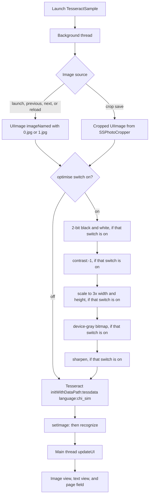

# ExperimentWithTesseract

[](https://github.com/aryansbtloe/ExperimentWithTesseract)
[](#requirements)
[](LICENSE)

ExperimentWithTesseract is an iOS sample that runs [Tesseract OCR](https://github.com/tesseract-ocr/tesseract) on two bundled photographs and exposes several switches that optimise the image before recognition. The running sample initialises Tesseract with the simplified Chinese language data (`chi_sim`). English traineddata is bundled as well, and the Objective-C wrapper can be pointed at it by changing the language argument. The app shows the image that was recognised and the UTF-8 text Tesseract returns.

## Features

- Recognises `0.jpg` (a page of vertical Chinese text) and `1.jpg` (a photographed Portuguese form). Both files sit at the repository root and are copied into the app as resources. The image index is clamped to `0...1`.
- Creates a `Tesseract` object with data path `tessdata` and language `chi_sim`, then calls `setImage:` and `recognize` on a background thread.
- Copies the bundled `tessdata` directory into the app Documents directory on first use and sets `TESSDATA_PREFIX` to that directory.
- Optional optimisation pipeline, applied only when the **optimise** switch is on. Each later switch is independent and runs in a fixed order: 2-bit black and white, contrast, 3× scale, grayscale, then sharpen.
- Crops the current image with `SSPhotoCropperViewController` (modal, zoom from 1.0 to 18.0) and recognises the cropped bitmap with the same pipeline.
- Shows the processed image in a scroll view and the recognised text in a read-only text view.
- Vendored Objective-C wrapper around `tesseract::TessBaseAPI`, plus the prebuilt static libraries `libtesseract_all.a` and `liblept.a`.

## How recognition runs



`initWithDataPath:language:` copies `tessdata` from the app bundle into Documents when that folder is missing, then calls `TessBaseAPI::Init`. An existing Documents copy is left unchanged.

## Requirements

Values below are the ones stored in `TesseractSample.xcodeproj`.

| Setting | Value |
| --- | --- |
| Project | `TesseractSample.xcodeproj` |
| Target | `TesseractSample` (`TesseractSample.app`) |
| Deployment target | iOS 6.0 |
| Architectures | `armv7` |
| SDK | `iphoneos` |
| Required device capability | `armv7` |
| C++ language | `gnu++0x` |
| C++ standard library | `compiler-default` on the target (`libc++` at project level) |
| Objective-C ARC | On for the target. `ImageFilter.m`, the `Curve` sources, and `SSPhotoCropperViewController.m` are compiled with `-fno-objc-arc` |
| Code sign identity | `iPhone Developer` for `iphoneos` |
| Last Xcode upgrade check recorded in the project | `0450` (Xcode 4.5) |
| Bundle identifier | `com.ldiqual.TesseractSample` |
| Version | 1.0 |
| Orientations | Portrait, landscape left, landscape right |

Linked by the target:

- `UIKit.framework`
- `Foundation.framework`
- `CoreGraphics.framework`
- `MobileCoreServices.framework`
- `TesseractSample/tesseract-ios-lib/lib/libtesseract_all.a`
- `TesseractSample/tesseract-ios-lib/lib/liblept.a`

`LIBRARY_SEARCH_PATHS` includes `$(SRCROOT)/TesseractSample/tesseract-ios-lib/lib`. Leptonica headers in this tree declare `LIBLEPT` 1.69.

The vendored `tesseract-ios` readme also states that its wrapper expects the iOS 6.0 SDK, iOS 5.0 or later, and does not support `armv6`. This Xcode project itself sets the deployment target to 6.0 and `ARCHS` to `armv7`.

## Installation

The repository is an Xcode project. Clone it and open the project:

```bash
git clone https://github.com/aryansbtloe/ExperimentWithTesseract.git
cd ExperimentWithTesseract
open TesseractSample.xcodeproj
```

In Xcode, select the `TesseractSample` scheme and build it for an armv7 device. The static libraries, headers, `tessdata`, sample JPEGs, and cropper nib are already referenced by the project. Signing uses the `iPhone Developer` identity configured on the target.

## Usage

On launch, `AppDelegate` loads `ViewController` from `ViewController.xib` and sets it as the window root. `viewDidLoad` sets the image index to `0` and starts recognition on a detached thread.

The toolbar contains a rewind button (previous image), a page text field, a fast-forward button (next image), a refresh button (reload), and an action button (crop). Under the text view, the switches are labeled **Gray Scale**, **2bit B/W**, **3x Scaling**, **optimise**, **sharpening**, and **constrast** (spelled that way in the xib). The switch outlets default to off, so the first recognition uses `0.jpg` with no optimisation. The page field uses the numbers-and-punctuation keyboard. Pressing Done calls `reloadImage:`.

Previous and next clamp the index with `MIN_IMAGE_NUMBER` (`0`) and `MAX_IMAGE_NUMBER` (`1`). Reload parses the text field with `intValue` and applies that index only when the value is greater than `0`, then clamps it to the same range. A blank field, a non-numeric field, or `0` leaves the current index in place.

### Recognition

Both the file path and the crop path construct Tesseract the same way. From `TesseractSample/ViewController.m`:

```objc
Tesseract* tesseract       = [[Tesseract alloc] initWithDataPath:@"tessdata" language:@"chi_sim"];
UIImage * imageToRecognise = [UIImage imageNamed:[NSString stringWithFormat:@"%d.jpg",currentImageUsed]];

if (imageToRecognise)
{
    if(optimiseImage.isOn)
        imageToRecognise = [self imageOptimisation:imageToRecognise];

    imageToDisplay = imageToRecognise;

    [tesseract setImage:imageToRecognise];
    [tesseract recognize];

    textToDisplay = [tesseract recognizedText];

    [self performSelectorOnMainThread:@selector(updateUI) withObject:self waitUntilDone:NO];
}
```

`updateUI` assigns the image, sizes the scroll view to the image, and writes the text view in this form:

```objc
[ocrDecodedOutputDisplay setText:[NSString stringWithFormat:@"\n\nRECOGNISED TEXT FOR IMAGE %@ is \n\n\n%@\n\n",[NSString stringWithFormat:@"%d.jpg",currentImageUsed],textToDisplay]];
```

The crop path uses the same calls, with the cropped `UIImage` in place of `imageNamed:`.

### Image optimisation

`imageOptimisation:` in `ViewController.m` runs only when **optimise** is on. Enabled steps run in this order:

```objc
if (twoBitBlackAndWhite.isOn)
    img = [self convertImageTo2BitBlackAndWhite:img];

if (contrast.isOn)
    img = [img contrast:-1];

if (scale.isOn)
    img = [img scaleToSize:CGSizeMake(img.size.width*3,img.size.height*3)];

if (grayScale.isOn)
    img = [self convertImageToGrayScale:img];

if (sharpening.isOn)
    img = [img sharpen];
```

- `convertImageTo2BitBlackAndWhite:` averages R, G, and B, divides by 255, and writes 255 when that intensity is above `0.8` and 0 otherwise.
- `contrast:` comes from the `UIImage (ImageFilter)` category. The sample passes `-1`. The category computes each channel as `(channel - 0.5) * amount + 0.5`.
- `scaleToSize:` is the `UIImage (scale)` category implemented in `ViewController.h`. It draws into a `UIGraphicsBeginImageContext` bitmap of the requested size.
- `convertImageToGrayScale:` draws the image into an 8-bit DeviceGray bitmap with `kCGImageAlphaNone`.
- `sharpen` is the 5×5 convolution in `ImageFilter.m`.

### Cropping

The action button calls `cropImage`, which presents the vendored cropper for the current JPEG:

```objc
UIImage *photo = [UIImage imageNamed:[NSString stringWithFormat:@"%d.jpg",currentImageUsed]];
SSPhotoCropperViewController *photoCropper =
[[SSPhotoCropperViewController alloc] initWithPhoto:photo
                                           delegate:self
                                             uiMode:SSPCUIModePresentedAsModalViewController
                                    showsInfoButton:YES];
[photoCropper setMinZoomScale:1.0f];
[photoCropper setMaxZoomScale:18.0f];
UINavigationController *nc = [[UINavigationController alloc] initWithRootViewController:photoCropper];
[self presentModalViewController:nc animated:YES];
```

`photoCropper:didCropPhoto:` keeps the cropped image, starts `decodeAndDisplayCroppedImage` on a background thread, and dismisses the modal. Cancel dismisses without recognising. The cropper’s own defaults, before this override, are a minimum zoom of `0.5` and a maximum zoom of `3.0`. Its info button shows the title “Crop Photo” and instructions to pinch-zoom and drag the green window.

### Tesseract wrapper

`TesseractSample/tesseract-ios/Classes/Tesseract.h` declares:

```objc
- (id)initWithDataPath:(NSString *)dataPath language:(NSString *)language;
- (void)setVariableValue:(NSString *)value forKey:(NSString *)key;
- (void)setImage:(UIImage *)image;
- (BOOL)setLanguage:(NSString *)language;
- (BOOL)recognize;
- (NSString *)recognizedText;
```

`initWithDataPath:language:` returns `nil` when `TessBaseAPI::Init` fails. `setVariableValue:forKey:` stores the pair and calls `TessBaseAPI::SetVariable`. `setLanguage:` reinitialises the engine and reapplies stored variables, because Tesseract resets parameters when the language changes. `setImage:` draws the `UIImage` into an RGBA buffer and passes that buffer to `SetImage`. `recognize` calls `Recognize(NULL)`. `recognizedText` returns `GetUTF8Text()` as an `NSString`.

`ViewController` calls `initWithDataPath:language:`, `setImage:`, `recognize`, and `recognizedText`. The wrapper’s own readme shows a direct use of the same API, including `setVariableValue:forKey:`, with English data and a character whitelist:

```objc
#import "Tesseract.h"

Tesseract* tesseract = [[Tesseract alloc] initWithDataPath:@"tessdata" language:@"eng"];
[tesseract setVariableValue:@"0123456789" forKey:@"tessedit_char_whitelist"];
[tesseract setImage:[UIImage imageNamed:@"image_sample.jpg"]];
[tesseract recognize];

NSLog(@"%@", [tesseract recognizedText]);
```

`eng.traineddata` is present in this repository, so the `language:@"eng"` argument matches a file that ships here. The image name in that snippet is `image_sample.jpg`. The images bundled with this sample are `0.jpg` and `1.jpg`.

## Project structure

```
ExperimentWithTesseract/
├── README.md
├── LICENSE
├── 0.jpg                          # sample image, index 0
├── 1.jpg                          # sample image, index 1
├── ImageFilter.h / ImageFilter.m  # UIImage filter category
├── Curve/                         # Bezier and spline classes used by ImageFilter
├── SSPhotoCropper/                # crop view controller, xib, and graphics
├── TesseractSample.xcodeproj/
└── TesseractSample/
    ├── main.m
    ├── AppDelegate.h / .m
    ├── ViewController.h / .m
    ├── TesseractSample-Info.plist
    ├── TesseractSample-Prefix.pch
    ├── en.lproj/ViewController.xib
    ├── Default.png, Default@2x.png, Default-568h@2x.png
    ├── tessdata/                  # chi_sim.traineddata, eng.traineddata, eng.cube.*
    ├── tesseract-ios/             # Objective-C Tesseract wrapper, its LICENSE, its README
    └── tesseract-ios-lib/
        ├── include/tesseract/     # Tesseract headers
        ├── include/leptonica/     # Leptonica headers
        └── lib/                   # libtesseract_all.a, liblept.a
```

`tessdata` contains `chi_sim.traineddata`, `eng.traineddata`, and the English cube files `eng.cube.bigrams`, `eng.cube.fold`, `eng.cube.lm`, `eng.cube.nn`, `eng.cube.params`, `eng.cube.size`, `eng.cube.word-freq`, and `eng.tesseract_cube.nn`.

## Customisation

These are the knobs the current source actually exposes.

| What to change | Where | Effect |
| --- | --- | --- |
| Language passed to Tesseract | `initWithDataPath:language:` in `decodeAndDisplayImage` and `decodeAndDisplayCroppedImage` | The sample passes `chi_sim`. `eng` matches `eng.traineddata` in the bundle. Any other language needs a matching `.traineddata` file inside `TesseractSample/tessdata`. |
| Tesseract variables | `setVariableValue:forKey:` on `Tesseract` | Stored and forwarded to `TessBaseAPI::SetVariable`. The sample never calls it. Changing language reloads the stored variables. |
| Which images exist | `MIN_IMAGE_NUMBER`, `MAX_IMAGE_NUMBER`, and JPEGs named `{n}.jpg` in the app resources | Previous, next, and reload stay inside that inclusive range. |
| Optimisation steps | Switches in `ViewController.xib`, read in `imageOptimisation:` | **optimise** must be on before any other step runs. |
| 2-bit cutoff | `THRESHOLD` in `convertImageTo2BitBlackAndWhite:` | Currently `0.8`. |
| Contrast amount | `[img contrast:-1]` | Argument to `UIImage (ImageFilter) contrast:`. |
| Scale factor | `scaleToSize:` call | Currently three times the current width and height. |
| Crop zoom | `setMinZoomScale:` / `setMaxZoomScale:` in `cropImage` | Currently `1.0` and `18.0`. |
| Cropper copy | `infoMessageTitle`, `infoMessageBody`, `photoCropperTitle` on `SSPhotoCropperViewController` | Defaults are set in the cropper’s initialiser. |

`ImageFilter.h` also implements these `UIImage` methods. The sample calls only `contrast:` and `sharpen`. The rest are available on the category:

`greyscale`, `sepia`, `posterize:`, `saturate:`, `brightness:`, `gamma:`, `opacity:`, `bias:`, `invert`, `noise:`, `levels:mid:white:`, `applyCurve:toChannel:`, `adjust:g:b:`, `edgeDetect`, `gaussianBlur:`, `vignette`, `darkVignette`, `polaroidish`, `overlay:`, and `lomo`.

`applyCurve:toChannel:` uses the `Curve` classes (`CatmullRomSpline` and the Bezier types). `CurveChannel` is a bit mask of `CurveChannelRed`, `CurveChannelGreen`, and `CurveChannelBlue`.

## Contributing

Issues and pull requests are welcome on [github.com/aryansbtloe/ExperimentWithTesseract](https://github.com/aryansbtloe/ExperimentWithTesseract). The Xcode project contains the `TesseractSample` application target.

Leave third-party copyright headers and license files in place when you change vendored code. `ImageFilter.m`, the files under `Curve/`, and `SSPhotoCropperViewController.m` are built without ARC; new code in those files has to follow that.

## License

Original work by Alok Singh in this repository is under the MIT License, copyright 2026 Alok Singh. The text is in [`LICENSE`](LICENSE). That grant covers Alok Singh’s own contributions, including the sample’s optimisation and cropping integration and this documentation.

Other material in the tree keeps its own license:

| Component | Copyright | License |
| --- | --- | --- |
| Tesseract headers and `libtesseract_all.a` | Google and Hewlett-Packard, as stated in each header | [Apache License 2.0](http://www.apache.org/licenses/LICENSE-2.0). Headers live in `TesseractSample/tesseract-ios-lib/include/tesseract/`. |
| Bundled `tessdata` (`eng`, `chi_sim`, and the English cube files) | Tesseract language data shipped with this sample | Apache License 2.0, with the Tesseract engine. |
| Leptonica headers and `liblept.a` | Copyright (C) 2001 Leptonica | BSD-style terms in the headers (see `include/leptonica/allheaders.h`): retain the copyright notice and disclaimer. Headers declare Leptonica 1.69. |
| `tesseract-ios` wrapper (`Tesseract.h`, `Tesseract.mm`) and the original sample files that still carry this copyright (`AppDelegate`, `main.m`, `ViewController`) | Copyright (C) 2012 Loïs Di Qual | MIT. The wrapper’s license file is [`TesseractSample/tesseract-ios/LICENSE`](TesseractSample/tesseract-ios/LICENSE). Its API notes are in [`TesseractSample/tesseract-ios/README.md`](TesseractSample/tesseract-ios/README.md). |
| `SSPhotoCropper` | Copyright 2011 Ahmet Ardal, SpinningSphere Labs | Apache License 2.0, in the header of `SSPhotoCropperViewController.h` and `.m`. |
| `ImageFilter.h` / `ImageFilter.m` | Copyright 2011 Perry Street Software, Inc. | MIT, as stated in the file headers. The `.m` file says that some filters are under the [ImageMagick License](http://www.imagemagick.org/script/license.php), and the noise filter is marked as adapted from ImageMagick. |
| `Curve/` | Copyright 2010 Bryan Spitz. All rights reserved. | No separate license file is included with these sources. |

The prebuilt libraries are the binaries checked in under `TesseractSample/tesseract-ios-lib/lib/`. Their headers are the license text available in this repository for those binaries.

## Author

Alok Singh

- GitHub: [https://github.com/aryansbtloe](https://github.com/aryansbtloe)
- Web: [https://bestlatestapps.com](https://bestlatestapps.com)
